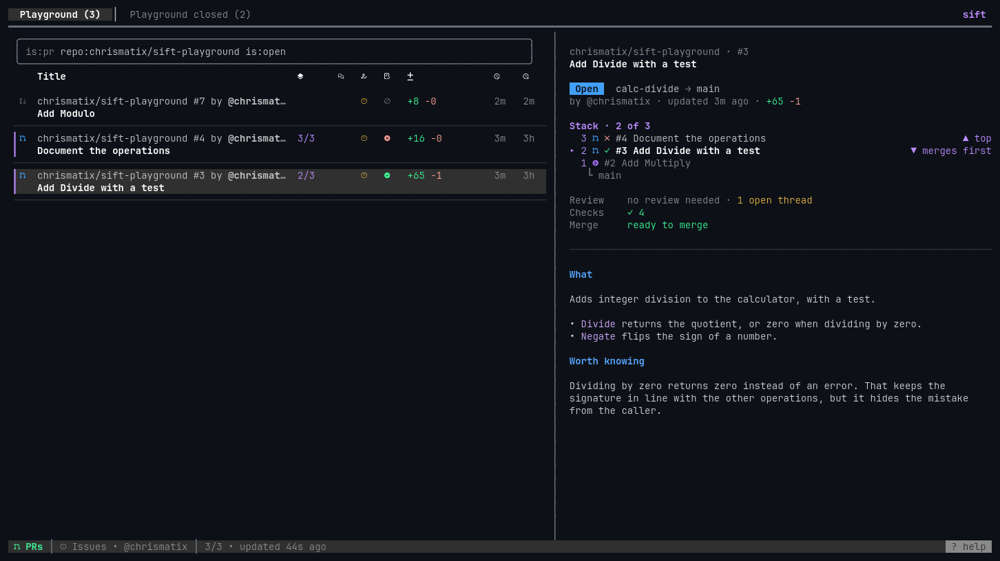
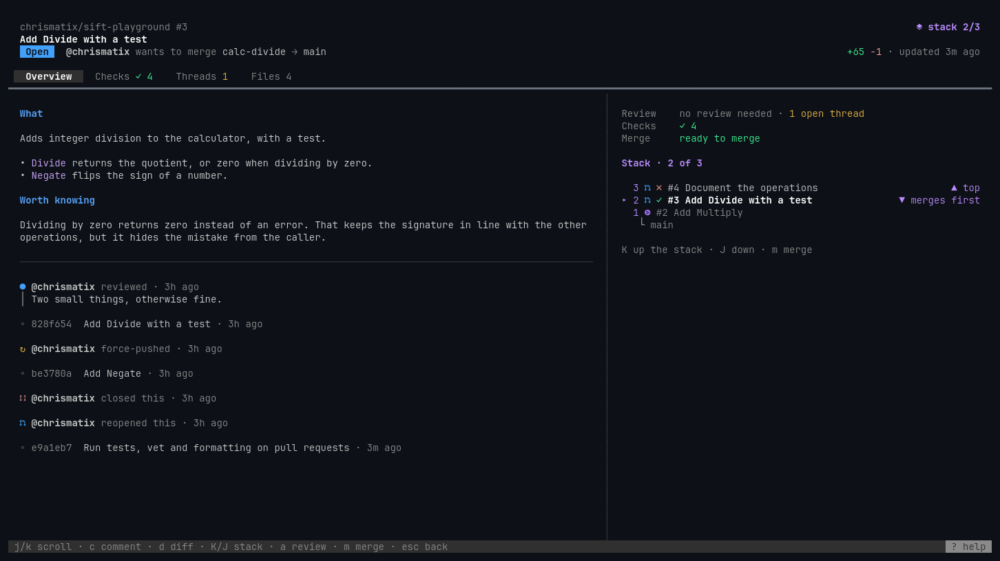
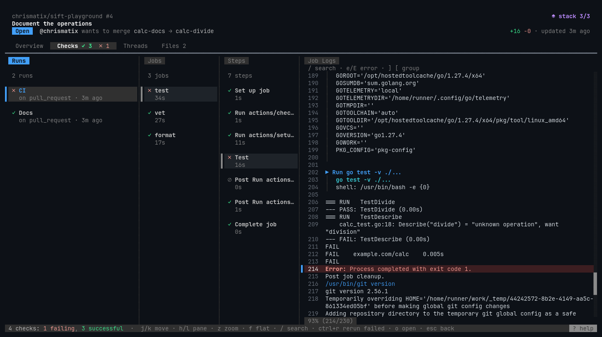
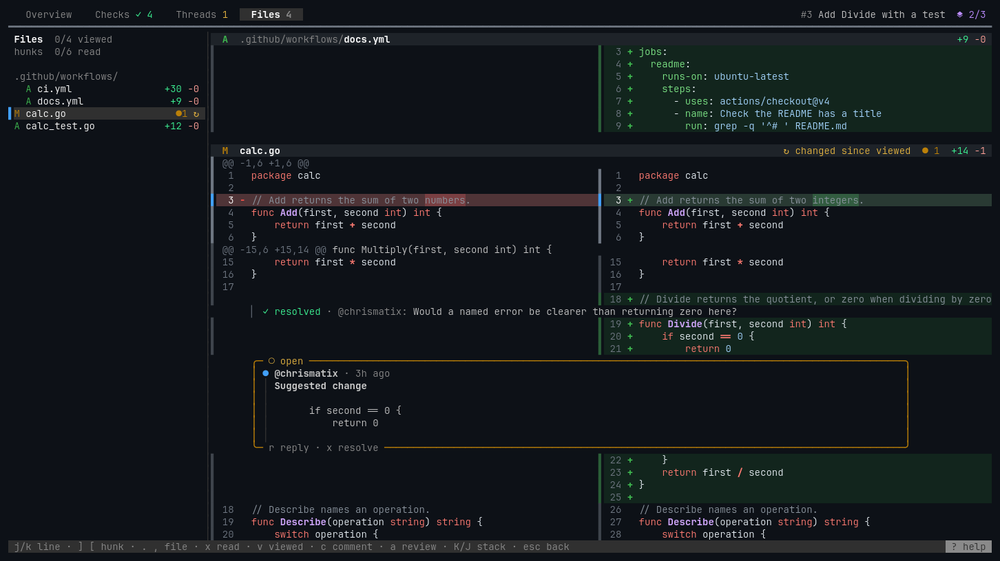
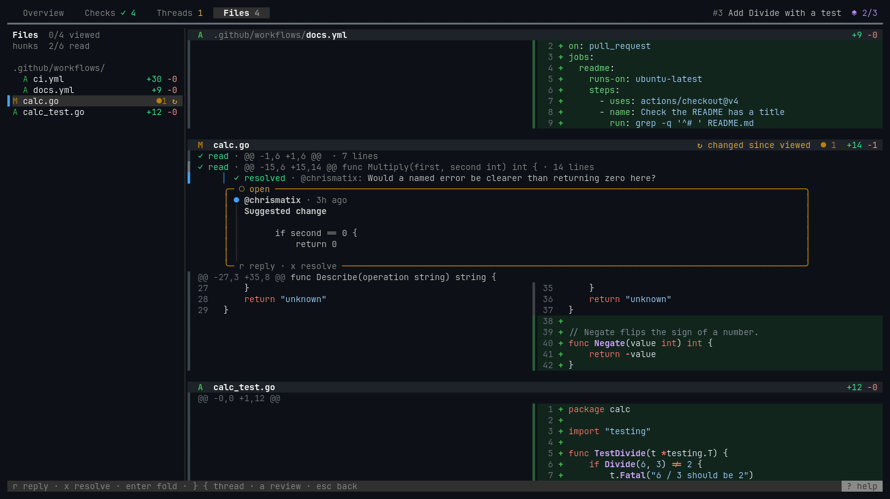

# gh-sift

<p>
  
  <a href="LICENSE"></a>
</p>

Sift **is** one terminal app for the whole GitHub pull request review.

Sift **reads** your [gh-dash](https://github.com/dlvhdr/gh-dash) config, so your sections and keys are already there.

Sift **remembers** what you have read, and treats stacked PRs as first class.

What it feels like:


## Highlights

- 📋 gh-dash's PR and issue lists, from the config file you already have
- 🔎 A full PR view in place: conversation, review threads, merge status
- 🥞 Stacked PRs everywhere: position in the list, the stack drawn top first, one key up or down, stack-aware merge
- 🚦 GitHub Actions in four panes that open on the failure, with the log at its error
- ↔️ A diff in the manner of hunk: file tree, split or stacked, syntax and word-level highlighting
- ✅ Read tracking: check off hunks, synced with GitHub's Viewed checkbox, so a re-review shows only what is new
- 💬 Review without leaving: comment, suggest, reply, resolve, approve
- 📦 One binary, one process, no pagers or panes glued together

## Installation

There are no release binaries yet, so sift is built from a checkout (Go 1.26 or newer):

```shell
git clone https://github.com/chrismatix/gh-sift && cd gh-sift
go build -o gh-sift .
gh extension install .
```

Then:

```shell
gh sift                      # the list, from your gh-dash config
gh sift 123                  # PR 123 of the repository you are in
gh sift owner/repo#123       # any PR; a PR URL works too
gh sift --config other.yml   # a config layered over the global one
```

Sift reads `~/.config/gh-dash/config.yml` (and `$GH_DASH_CONFIG`, and `.gh-dash.yml` in the repository) and never writes to it; without one it uses gh-dash's default sections. `gh` must be authenticated, merging a stack needs the [gh stack](https://github.com/github/gh-stack) extension, and the list's glyphs need a [Nerd Font](https://www.nerdfonts.com), as in gh-dash.

`SIFT_READ_ONLY=1 gh sift` refuses every write, for looking around a repository you must not touch.

## A tour

### The list



gh-dash's sections, columns, search bar, preview and keys. PRs in a GitHub stack show their position (`2/3`), the rows of the stack under the cursor share a rail, and the preview draws the stack. `enter` opens the PR, `d` goes straight to its diff.

### The PR and its stack



The description and conversation in one scroll, with what stands between the PR and merging beside it. The stack is always drawn top first, with the base branch underneath and the PR that merges first labelled. `K` and `J` move to the PR above and below from every screen; neighbours are fetched ahead, so the move is instant. `m` merges a stacked PR together with what is below it, or the whole stack.

### Checks



Runs, the run's jobs, the job's steps and the log, side by side. The tab opens on what failed, and picking a step scrolls the log to it. `h`/`l` move between panes, `z` zooms one, `/` searches the log, `ctrl+r` reruns the failed runs.

### The diff, and coming back to it



One scroll through every file, with review threads as cards under their lines. `c` comments on a line, `S` suggests a change, `r` replies, `x` resolves; comments collect in your pending review until `a` submits it. `x` on code checks the hunk off as read, and a file whose hunks are all read is marked Viewed on GitHub.



When the author pushes again, GitHub clears the Viewed mark of every file that changed. Sift still knows which hunks you read, so only the new ones are open: here two hunks of `calc.go` are folded and the added function is what is left.

`?` shows the keys of the screen you are on.

## Where it comes from

Sift exists because four good tools each do one part of a review, and running them side by side means three processes that share nothing. It borrows from each on purpose:

| | What sift takes | Where it differs |
|---|---|---|
| [**gh-dash**](https://github.com/dlvhdr/gh-dash) | The list: its config file and schema, sections and filters, the two-line table with its columns, glyphs and colours, the preview, the default keys, and custom commands. | `enter` opens a PR view and a diff in the same process, where gh-dash has a preview pane and an external pager. Stacks are visible in the list. The list is cached on disk and its query is leaner, so it is on screen at once. No notifications or branches view yet. |
| [**gh pry**](https://github.com/chrismatix/gh-pry) | The PR: a conversation timeline, threads with CodeRabbit's severity, the stack drawn top first with both ends labelled, merging through `gh stack merge`. | Each tab gets the whole screen instead of a list above a preview. The stack comes from GitHub's stack API rather than from walking base branches. The diff is built in, where gh pry hands off to hunk. |
| [**hunk**](https://github.com/modem-dev/hunk) | The diff: one scroll through all files, the file tree, a coloured rail that dims outside the current hunk, split and stacked layouts, word-level emphasis, notes as cards under their line, the keymap and the GitHub palette. | The cards are GitHub review threads you can reply to and resolve, and new comments go to a pending review; hunk's notes are local, for you and your agent. Hunks can be marked read, tied to GitHub's Viewed checkbox. Sift only shows PRs: hunk also reviews local changes, expands context, wraps lines, takes the mouse, and has themes, extensions and an agent bridge. |
| [**gh-enhance**](https://github.com/dlvhdr/gh-enhance) | The Checks tab: the four panes, opening on the failure, and finding a step in the log by its start time. | It lives inside the PR view, so flat mode is `f` because `m` merges. Third-party checks show the summary they report. Search is a plain substring where gh-enhance also has regex and fuzzy, and there is no repository-wide list of runs. |

## Keys

The list keeps gh-dash's defaults and honours `keybindings:` from the config. The diff keeps hunk's keys and the Checks tab gh-enhance's. These are sift's own:

| Key | Where | Does |
|---|---|---|
| `enter` / `d` | list | open the PR / its diff |
| `K` / `J` | everywhere | PR above / below in the stack |
| `m` | everywhere | merge, stack aware |
| `tab`, `1`-`4` | PR view | switch tab |
| `a` | PR view, diff | submit a review |
| `x` | diff | check off: hunk read, thread resolved |
| `v` | diff | file viewed on GitHub |
| `c` / `S` / `V` | diff | comment / suggest / select lines |
| `esc` or `q` | PR view, diff | back one level |

## Documentation

- [docs/status.md](docs/status.md): what works, what does not yet, and what is next.
- [docs/design.md](docs/design.md): the review of the tools above and the decisions sift makes.

## Development

```shell
go test ./...
scripts/tui.sh start 170 44 owner/repo#123   # run it in a detached tmux, read-only
scripts/tui.sh shot diff                     # the screen as a PNG
scripts/demo.sh                              # re-record the demo with VHS
```

## Versioning

Sift is pre-release: anything may change between commits until there is a tagged version.
